# Chukwuma Zikora

### DevOps / Platform Engineer

CI/CD · Containers · Kubernetes · Observability · Infrastructure automation

---

## About

I build and operate the systems that ship software reliably.

After 10+ years as a software engineer (healthcare SaaS and product work), I deliberately shifted into **DevOps / Platform Engineering**. Today I care about one question: can we deploy safely, observe clearly, and recover fast?

**Open to:** DevOps Engineer · Platform Engineer · Cloud Engineer · Junior-mid SRE (remote)

📍 Nigeria · Africa / EU-friendly hours

---

## What I work with

  

| Area                           | Tools                                                               |
| ------------------------------ | ------------------------------------------------------------------- |
| **Containers & orchestration** | Docker, Docker Swarm, Kubernetes, Helm, kubeadm, Minikube, MicroK8s |
| **CI/CD & automation**         | GitHub Actions, GitLab CI/CD, CircleCI, Ansible, Vagrant            |
| **Cloud & infra**              | AWS (Lambda, API Gateway), Proxmox, Ubuntu Linux                    |
| **Observability**              | Prometheus, Grafana, Loki, Alertmanager, Grafana Alloy, cAdvisor    |
| **Supporting app stack**       | TypeScript, Node.js, NestJS, PostgreSQL, REST APIs                  |

---

## Featured infrastructure labs

Public homelab and platform work in [`playground-devops`](https://github.com/chukwumaijem/playground-devops):

| Project                                                                               | What it demonstrates                                                                                                                          |
| ------------------------------------------------------------------------------------- | --------------------------------------------------------------------------------------------------------------------------------------------- |
| **[Platform Homelab](https://github.com/chukwumaijem/playground-devops)**             | Proxmox multi-VM setup, Docker Swarm, Caddy Docker Proxy (label-driven HTTPS), Prometheus / Grafana / Loki / Alertmanager, Alloy log shipping |
| **[Container Egress Gateway](https://github.com/chukwumaijem/playground-devops)**     | Deny-by-default egress with Ansible + Squid + iptables `DOCKER-USER`; Swarm demo for compliant vs rogue containers                            |
| **[Helm Multi-Service Packaging](https://github.com/chukwumaijem/playground-devops)** | Umbrella + per-service Helm charts for a multi-tier app on Minikube / MicroK8s; kubeadm multi-node practice                                   |

---

## Production systems & tooling

| Project                | Role                                                                         | Link                                                          |
| ---------------------- | ---------------------------------------------------------------------------- | ------------------------------------------------------------- |
| **Property Governors** | Lead engineer - live property SaaS; owned cloud infra + deployment pipelines | [propertygovernors.com](https://propertygovernors.com)        |
| **FirmLyt**            | Lead engineer - legal SaaS; AWS + Docker, CI/CD end-to-end                   | [firmlyt.com](https://firmlyt.com)                            |
| **Notifier**           | Self-hostable email microservice (Docker, dual auth, rate limiting)          | [blockqueue/mailer](https://github.com/blockqueue/notifier)   |
| **BQ Queue**           | PostgreSQL-backed job queue + signed webhook delivery                        | [blockqueue/bq-queue](https://github.com/blockqueue/bq-queue) |

At **ShiftHealth** I design and maintain GitHub Actions + Docker CI/CD for a multi-environment healthcare platform, and have migrated workloads toward AWS serverless where it fits.

---

## GitHub analytics

  
  

---

## Focus right now

- Deepening Kubernetes operations (Helm, multi-node, observability on cluster)
- Shipping GitOps (Argo CD) and production-shaped platform labs publicly
- Keeping BlockQueue SaaS reliable in production
- Looking for DevOps / Platform / SRE roles with real ownership of pipelines and reliability

---

## Links

- **Portfolio:** [chukwumaijem.github.io](https://chukwumaijem.github.io/)
- **Labs:** [github.com/chukwumaijem/playground-devops](https://github.com/chukwumaijem/playground-devops)
- **LinkedIn:** [linkedin.com/in/chukwumazikora](https://www.linkedin.com/in/chukwumazikora)
- **Email:** [chukwuma.zikora@gmail.com](mailto:chukwuma.zikora@gmail.com)

---

If you're hiring for DevOps or Platform Engineering, I'm happy to walk through the homelab in 15 minutes.
